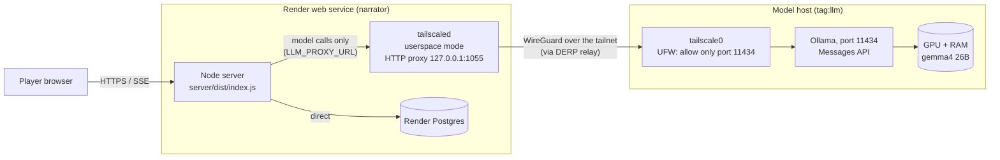
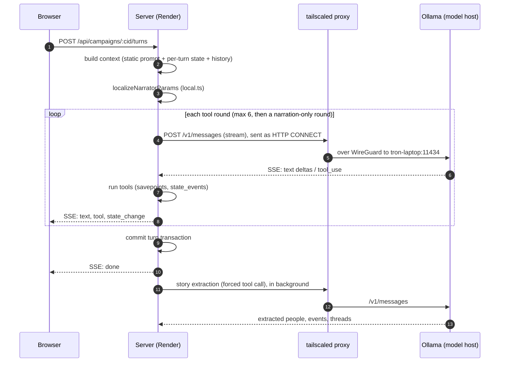

# Narrator

A single-user interactive story engine. An AI narrator runs a persistent world, and the database is the source of truth for game state.

The narrator runs on either Claude (Anthropic API) or a self-hosted model served by Ollama. In production, the Render service reaches a self-hosted model on a home machine over Tailscale. See [Model backend](#model-backend-claude-or-a-self-hosted-model).

## Layout

| Path       | What                                                                    |
| ---------- | ----------------------------------------------------------------------- |
| `/server`  | Fastify API, turn engine, Drizzle schema. Bundled with esbuild to `server/dist`. |
| `/web`     | React + Vite + Tailwind SPA. Built to `web/dist` and served by the server. |
| `/shared`  | Shared types and zod schemas (TS source, bundled into both sides).      |
| `/drizzle` | Committed SQL migrations generated by drizzle-kit.                      |
| `/deploy`  | Render start/build scripts for Tailscale, and the reference tailnet access policy. |

## Local development

Requires Node 20.12+ and Docker (for Postgres).

```sh
npm install
cp .env.example .env        # then set APP_PASSWORD and SESSION_SECRET
npm run db:up               # start Postgres in Docker
npm run db:migrate:dev      # apply migrations
npm run seed                # create the demo campaign (Varenhold)
npm run dev                 # server on :3000, Vite on :5173 (proxies /api)
```

Open http://localhost:5173.

To develop against a local Ollama instead of Claude, set `LLM_BASE_URL=http://localhost:11434` and name the Ollama model in both `NARRATOR_MODEL` and `UTILITY_MODEL` (see [.env.example](.env.example)).

Other scripts:

- `npm run dev:demo`: like `npm run dev`, but the narrator is a scripted fake ([demo-server.ts](server/scripts/demo-server.ts)) that calls real tools. Use it to work on the UI without an API key or API costs.

- `npm test`: server tests (vitest). Database tests run against PGlite (in-process Postgres), so Docker is not needed for tests.
- `npm run seed -- --world brinecross` seeds a different world, `--all` seeds every world, and `--reset` deletes and recreates the demo campaign(s). Other campaigns are untouched.
- Worlds are plain data in [server/src/db/seed/worlds/](server/src/db/seed/worlds/). To add one, write a file there and list it in [templates.ts](server/src/db/seed/templates.ts); it appears as a template in the New Campaign form.
- `npm run typecheck`: all workspaces
- `npm run build && npm start`: production build served from one process on `PORT`. `npm start` runs [deploy/start.sh](deploy/start.sh), which joins the tailnet first only when `TS_AUTHKEY` is set (on Render); otherwise it just starts the server.
- `npm run db:generate`: generate a migration after changing `server/src/db/schema.ts`

## API

All routes under `/api` except `/api/auth/*` require the session cookie. Request bodies are validated with the zod schemas in `shared/src/entities.ts`.

| Route | Methods |
| --- | --- |
| `/api/campaigns` | GET (list), POST |
| `/api/campaigns/:cid` | GET, PATCH, DELETE (cascades) |
| `/api/campaigns/templates` | GET: worlds a campaign can start from |
| `/api/campaigns/from-template` | POST `{ templateId, name, includeCharacter }` |
| `/api/campaigns/:cid/character` | GET, PUT (upsert), PATCH |
| `/api/campaigns/:cid/character/sheet` | GET, PUT: character, skills, and items saved together in one transaction (used by the builder) |
| `/api/campaigns/:cid/{skills,items,locations,npcs,relationships,lore,missions}` | GET, POST |
| `/api/campaigns/:cid/{collection}/:id` | GET, PATCH, DELETE |
| `/api/campaigns/:cid/turns` | POST `{ content }`: play a turn. Responds with a Server-Sent Events stream (`turn_start`, `text`, `tool`, `state_change`, then `done` or `error`) |
| `/api/campaigns/:cid/turns/undo` | POST: revert the last turn (narrative and state) |
| `/api/campaigns/:cid/messages`, `/events` | GET, paginated (`?limit=&before=`) |
| `/api/campaigns/:cid/turns/:turn/debug` | GET |
| `/api/campaigns/:cid/state` | GET: the play screen's sidebar snapshot |
| `/api/campaigns/:cid/memory` | POST: run memory upkeep now (fold the summary, condense notes) instead of waiting for it to come due |

These routes are for editing, outside the fiction: they do not write `state_events`, and marking a mission completed here does not grant its rewards. In-story changes go through the turn engine's write tools.

## Turn engine

The engine lives in `server/src/engine/`. Each turn:

1. **Context** ([context.ts](server/src/engine/context.ts)): a cached static block (narrator prompt, world bible, style) plus a small per-turn block: the one-line character header, current location, every open mission with its next objective (and offered ones by title), rolling summary, always-include lore, and records whose names appear in the player's message (NPC plus relationship, items, locations, lore). Everything else stays out, and the narrator fetches it with read tools. The `turn_debug.context_manifest` records what was included and why.
2. **Narrator loop** ([narrator.ts](server/src/engine/narrator.ts)): streams text, runs tool calls between rounds, and caps tool use at 6 rounds before forcing narration. With a self-hosted model, each request is adapted on the way out by [local.ts](server/src/engine/local.ts) (see [Request adaptation](#request-adaptation-for-local-models)).
3. **Tools** ([tools.ts](server/src/engine/tools.ts)): 9 read tools and 21 write tools, validated with zod. Invalid input goes back to the model as an error it can correct.
4. **Writes** ([mutator.ts](server/src/engine/mutator.ts)): each tool call runs in a savepoint and records row-level before/after diffs in `state_events`, which is what makes undo exact.
5. **Atomicity**: the whole turn is one transaction. If the model call fails, nothing is saved.

### Progression

The numbers live in [rules.ts](shared/src/rules.ts), shared by the engine and the UI.

- **Checks** roll d20 + skill level + level bonus (+ attribute bonus under ascension) against DC 8/12/16/20. The level bonus is +1 at levels 4, 7, 10, 13, and 16 (capped at +5). From skill level 6, a natural 1 no longer fails automatically.
- **Skill XP** costs 25 × (level + 1) per level. A check pays 5/10/16/25 XP by difficulty (less on a partial or a failure). Tiers: Novice 0, Apprentice 3, Journeyman 6, Expert 10, Master 15, Grandmaster 20.
- **Character XP** costs 50 × (level + 1) per level; each level adds 3 max HP (and under ascension, +1 to every attribute plus 1 free stat point; 3 attribute points = +1 to checks).
- **Gear** has a grade: 0 (ungraded, ordinary or merely well made) or Grade I to VII, worth +1 to +7 on the checks it enhances (a named skill, or an attribute). Worn gear (rings, charms, armor) counts whenever it's equipped. A wielded item (weapon, tool) counts only when the narrator names it as `using` in `skill_check`. At most one of each counts on a roll, so trinkets don't stack. The narrator sees the equipped graded gear every turn, sets grades with `add_item` / `update_item`, and you can edit them in the Pack panel. A check result says when gear decided the outcome (`gearMadeTheDifference`, "⚙ gear decided it").
- **Visible impact.** A check result says when the character's training changed the outcome (`trainingMadeTheDifference`). The narrator is told to show it in the story, and the turn shows it as a chip ("✦ training decided it"). Each saved turn keeps its rolls and level-ups under the narration (`highlights` on narrator messages).
- **Time skips.** The ⏩ button sends a time-skip request, and the narrator calls `pass_time`. That tool grants 15 skill XP per training day on the main focus (half for side skills, ×1.5 with a teacher, half without one past level 10), 5 character XP per day, and 25% HP per day of rest, and advances the in-game day (daily quests are kept up, with no rewards or penalties). The narrator plays out the montage, then resumes the story. One skip covers at most 90 days.

- **Routines.** `set_routine` records something the character does every night (skills, hours, teacher), stored in `player_character.routines` and editable in the character builder. `advance_day` trains active routines every night, and `pass_time` trains them once per day skipped, at the time-skip rates with the hours shared between the routine's skills.
- **Ending the day** (ascension). `advance_day` refuses to end the day while an active daily quest has unticked objectives, until the narrator passes `daily_review` saying which were met. Those are ticked first, so a quest finished by its last objective is completed and rewarded rather than failed. It also refuses a second new day within a turn of the last one unless `new_night: true` says another night really passed.

### Keeping state in step

- **Hand corrections.** Edits from the UI (the collection endpoints, the character routes, and campaign settings) go through the Mutator too. Once play has started, each edit is recorded as a `manual_edit` event on the latest turn. The next turn's context lists them under "Player corrections since your last turn", `search_past_events` finds them, and undoing that turn reverts them with it. A save while a turn is running gets a 409 instead of waiting for it.
- **NPCs in the scene.** Besides NPCs named in the player's message, each turn fetches up to 3 NPCs named in the last narration. Each fetched record says when it last changed, and one untouched for 50+ turns is flagged `stale` so the narrator brings it up to date.

### Story depth

- **Story notes.** `update_story_notes` keeps the narrator's private planning notes (open threads, secrets, planted clues, what NPCs are doing offscreen) in `campaigns.story_notes`. They appear in every turn's context and never in the player's UI (except the debug drawer).
- **Locations with a purpose.** Every location has a GM-only `purpose` (what it's for in the story: a mission step, a secret it holds, whose base it is). The narrator sees the current location's purpose and every place's name each turn; the player's map shows only descriptions. `create_location` requires a purpose, and `update_location` revises one. Every seeded world has at least 6 locations (`MIN_WORLD_LOCATIONS`); a campaign with fewer is told to create the missing ones that turn.
- **Faction reputation.** A world can track the character's standing with named factions (`campaigns.reputation`, -100 to 100, seeded from the template's `reputation`). It is shown every turn, `adjust_reputation` changes it, and any NPC whose `faction` matches a tracked name carries that standing in its record. Worlds that track none are unaffected.
- **Permanent choices.** A world can offer choices made once and never changed, such as a starting skill (`campaigns.choices`, from the template's `choices`). The play screen shows a pending choice as a System panel with one button per option. The narrator locks the pick with `lock_choice`, which applies the option's grants (skills, items, conditions), creates the NPCs that options passed over bring into the world (offscreen, unmet), and refuses any later change. Undoing the turn reopens the choice.
- **Narration length.** `campaigns.narration_length` (`brief` / `standard` / `rich`, set in the sidebar's Log tab) is restated every turn.

Dice are server-side and seeded by (campaign seed, turn, roll index), so undoing a turn and replaying it gives the same rolls.

### Memory

After each turn, [memory.ts](server/src/engine/memory.ts) does upkeep in the background with `UTILITY_MODEL`. It never runs in the player's request.

- **Rolling summary.** The narrator sees every message not yet summarized. Every `summary_interval` turns (default 10), or sooner once that history passes ~6k tokens, everything older than the last `history_window` messages (default 8) is folded into `campaigns.rolling_summary`, which is kept under ~800 tokens. Folded messages are marked `summarized`.
- **Relationship notes.** After 4 new `adjust_relationship` notes, or once an NPC's notes grow long, they are condensed into 3-6 bullets.
- **Search.** `search_past_events` searches past state changes and the folded story passages (full-text, with snippets). If no result has every keyword, it retries matching any of them.

Memory writes go through the Mutator and are recorded on the latest turn, so undo reverts them with that turn. The model runs outside any transaction. Its result is saved only if its inputs are unchanged; otherwise it is dropped and retried after the next turn.

## Model backend: Claude or a self-hosted model

All model calls go through [anthropic.ts](server/src/engine/anthropic.ts) using the Anthropic SDK. They target one of two backends:

| Backend | Selected when | Notes |
| --- | --- | --- |
| **Self-hosted** (Ollama) | `LLM_BASE_URL` is set | Ollama serves the Anthropic Messages API at `/v1/messages`, so the same SDK calls work. Requests are adapted for local models. |
| **Claude** | `LLM_BASE_URL` is unset and `ANTHROPIC_API_KEY` is set | The original behavior, unchanged. |
| None | Neither is set | The app boots, but turns return 503 and memory upkeep is off. |

There are three kinds of call, and all three use the same backend:

| Call | Code | Shape |
| --- | --- | --- |
| Narrator | `createAnthropicStream` → [narrator.ts](server/src/engine/narrator.ts) | Streaming, up to 33 tools, multi-round tool loop |
| Story extraction | `createAnthropicStructured` → [extract.ts](server/src/engine/extract.ts) | One request with a forced tool call (`tool_choice: { type: 'tool' }`) |
| Memory upkeep | `createAnthropicUtility` → [memory.ts](server/src/engine/memory.ts) | One plain text request |

With a self-hosted model, `NARRATOR_MODEL` and `UTILITY_MODEL` should name **the same model**. Only one large model fits in memory, and switching models costs a 15–35 s reload on every switch.

### Production topology



- The Render node joins the tailnet as `tag:render`, and the model host is `tag:llm`. The tailnet policy allows exactly one flow, `tag:render → tag:llm:11434`.
- Only model calls use the proxy. The database, and Anthropic if it is used, connect directly.
- Ollama has no authentication of its own. It is protected by two layers: the tailnet policy (only `tag:render` and your own devices can reach it) and the host firewall (port 11434 is open only on the `tailscale0` interface, never on the LAN).

### Data flow of one turn



The next turn waits up to `EXTRACTION_WAIT_MS` (10 s) for the previous extraction to finish, so its context is current. Ollama serves one request at a time (`OLLAMA_NUM_PARALLEL=1`), so a turn sent while an extraction is running queues behind it. At normal reading speed the extraction has finished by the time the player sends the next turn.

### Request adaptation for local models

Claude-specific request features don't carry over to a local model. Rather than change the narrator loop or context builder, [local.ts](server/src/engine/local.ts) rewrites each narrator request just before it is sent. It does this only when `LLM_BASE_URL` is set:

| Claude request | Local model problem | Adaptation |
| --- | --- | --- |
| `system: [static, per-turn state]`, then history | Ollama reuses its KV cache only for an identical prompt prefix, and the chat template places tools *after* the system text. The per-turn state changed every turn, so the tools and the entire history were re-processed each time (~9k tokens, ~20 s). | The per-turn state moves into this turn's player message, wrapped in `<current_state>`. The prefix `system → tools → history` then stays identical across turns and tool rounds, and only ~1.5k new tokens are processed per turn. |
| "Never write the player's dialogue" is in the long system prompt | Small models don't follow rules buried deep in a long prompt. | A one-line reminder is placed just before the player's message. |
| `tool_choice: { type: 'none' }` on the final round | Ignored: the model still calls tools, leaving the turn with no narration. | The final round sends no tools at all. |
| `thinking: adaptive`, `output_config.effort` | Not supported (Ollama accepts and ignores them). | Removed. |

### Context budget and repeat guard

Two safeguards cover failure modes that Claude doesn't have but a small local model does:

- **Context budget** ([local.ts](server/src/engine/local.ts) `fitToContext`, local mode only). Ollama's context window is small: 32k tokens here, against Claude's 200k+. Past it, Ollama silently drops the *start* of the prompt, which is where the narrator's rules are. Before each narrator request, the adapter estimates its size (JSON characters ÷ 4, which measured ~4% above Qwen3's real count) and, if it exceeds `LLM_CONTEXT_TOKENS` minus a 3,000-token reserve for the reply, drops the **oldest history** until it fits. Older events are already in the rolling summary. The system prompt, tools, world state, the player's message and the current turn's tool rounds are never dropped. Each trim is logged as `Narrator prompt over the model context budget` (component `llm`). In a long campaign, the system prompt, tools and world state alone took ~23k tokens, leaving ~5k for history. If the world state keeps growing, raise the context window on both sides (Ollama and `LLM_CONTEXT_TOKENS`), which needs more VRAM.
- **Repeat guard** ([repeat.ts](server/src/engine/repeat.ts), all backends). Small models sometimes reproduce their previous narration almost word for word, and once a copy is saved, the history teaches the model to keep repeating (seen in play: three repeats in a row until the turns were undone). After each turn, the narration is compared with the previous one by shared word triples. At 60% or more, the turn fails with a retryable "The narrator repeated its last response. Nothing was saved; try again." Because the turn's transaction rolls back, the copy never reaches the history. Ordinary consecutive narrations of the same scene measured 0–16%. Replies under ~20 word triples are not checked.
- **Loop guard** (same file, all backends; output cap in local mode). A small model can also loop *within* one response, writing the same passage until it runs out of room. With the app's 16k-token output limit, that ran for 2.5 minutes in play before the request was cut off. In local mode, narrator output is capped at 2,048 tokens (`LOCAL_MAX_OUTPUT_TOKENS`; a narration is 300–600), so a loop ends within about a minute. Any narration whose own word triples are 40%+ repeats is discarded like a repeat, and nothing is saved. Real narrations measured 0–1.6%, and a passage repeated three times measures 66%.
- **Not used: a presence penalty.** Qwen recommends `presence_penalty` against repetition, and Ollama applies it as a model setting, but in testing it stopped the narrator from calling tools (1 call in 8 turns instead of several per turn), so state stopped being tracked.

`cache_control` markers are left in place; Ollama ignores them. Requests to Claude are never adapted. The SDK client for a local backend uses a 10-minute timeout and 1 retry, instead of 2 minutes and 3 retries, because a retry repeats a long prompt-processing step on the same GPU.

### Measured performance

Measured with Qwen3-30B-A3B-Instruct-2507 (Q4_K_M) on a laptop with an RTX 4070 Mobile (8 GB VRAM) and 64 GB RAM, about 14k-token prompts, and a pause between turns as in real play:

| | |
| --- | --- |
| Generation | ~30 tokens/s |
| Prompt processing (uncached) | ~430 tokens/s |
| Time to first text, typical turn | 7–9 s (1–2 tool rounds) |
| Time to first text, tool-heavy turn | ~22 s (4 tool rounds) |
| Full turn | 20–35 s |
| First turn after Ollama restarts | ~35 s extra (whole prompt processed once) |
| Story extraction (background) | 13–25 s |

For comparison, the hybrid-thinking `qwen3:30b-a3b` took 40–75 s per turn and rarely called tools, which is why the instruct model was used at first.

**Gemma 4 26B with thinking (current).** In a long campaign (~430 turns, ~20k-token prompts), Qwen3 drifted within about ten turns into one-line "Not with X. With *Y*." fragments, copied its own previous reply, and almost never called tools. Replaying the same real prompt:

| Model | Turn time | Paragraphs (one-liners) | Tool calls |
| --- | --- | --- | --- |
| Qwen3 30B-A3B instruct | 35–43 s | 27–60 (14–49) | 0 |
| Gemma 4 26B, thinking off | 61–73 s | 8–16 (1–5) | 0 |
| Gemma 4 26B, thinking on (4,000-token budget) | 110 s | 9 (1) | 3 |

On the laptop a thinking turn takes about 1.5–2.5 minutes, and the text starts only once the reasoning ends (60–90 s). The prose and state tracking are worth the wait, so production runs `gemma4:26b` with `LLM_THINKING_TOKENS=4000`. Background jobs never think and take 2–3 s each. Without an explicit setting, Gemma thinks by default and spends the whole output cap on reasoning, so the adapter always sets thinking on or off.

### Configuration

| Variable | Where | Purpose |
| --- | --- | --- |
| `LLM_BASE_URL` | server | Base URL of the Anthropic-compatible model server, e.g. `http://tron-laptop.tail57bc3.ts.net:11434`. Setting it switches every model call to that server. |
| `LLM_API_KEY` | server (optional) | Sent as the API key. Ollama ignores it, but an authenticating proxy in front of it may need it. Redacted in logs. |
| `LLM_CONTEXT_TOKENS` | server (default `32768`) | The self-hosted model's context window. **Must match `OLLAMA_CONTEXT_LENGTH`** on the model host. Narrator prompts are trimmed to fit it (see [Context budget](#context-budget-and-repeat-guard)). |
| `LLM_THINKING_TOKENS` | server (default `0`) | Reasoning budget for a self-hosted narrator that thinks (Gemma 4), added on top of the 2,048-token output cap and kept free in the context budget. `0` turns thinking off. Background jobs always run with thinking off. |
| `LLM_PROXY_URL` | server (optional) | HTTP proxy used for model calls only, through undici's `ProxyAgent` (HTTP CONNECT). On Render this is `http://127.0.0.1:1055`, tailscaled's outbound proxy. |
| `NARRATOR_MODEL`, `UTILITY_MODEL` | server | Model names on the selected backend. For Ollama, use the same model for both. |
| `TS_AUTHKEY` | Render (secret) | Tailscale auth key used by [deploy/start.sh](deploy/start.sh) to join the tailnet. It must be reusable, ephemeral, and tagged `tag:render`. |
| `TS_HOSTNAME`, `TS_PROXY_PORT`, `TS_VERSION` | Render (optional) | Override the node name (`narrator-render`), the proxy port (`1055`), and the Tailscale version downloaded at build time (`1.104.7`). |
| `ANTHROPIC_API_KEY` | server | Used only when `LLM_BASE_URL` is unset. Keep it on Render as the fallback. |

### Render side: joining the tailnet

Render's native Node runtime has no root access and no TUN device, so tailscaled runs in userspace-networking mode and exposes a local HTTP proxy instead of a network interface. This is wired through `npm` scripts, so it works whether the service is managed by the Blueprint or configured in the dashboard:

- **Build** (`npm run build`): after the web and server builds, [deploy/tailscale-install.sh](deploy/tailscale-install.sh) downloads the Tailscale static binaries into `.tailscale/` (git-ignored) and checks their SHA-256. It runs only when `RENDER=true`, or when `TS_INSTALL=1` to test locally.
- **Start** (`npm start`): [deploy/start.sh](deploy/start.sh) does the following when `TS_AUTHKEY` is set:
  1. starts `tailscaled --tun=userspace-networking --state=mem: --outbound-http-proxy-listen=127.0.0.1:1055`, logging to `/tmp/tailscaled.log`;
  2. runs `tailscale up --authkey=$TS_AUTHKEY --hostname=narrator-render` with a 60 s timeout;
  3. checks `$LLM_BASE_URL/api/version` through the proxy, the same path the app uses;
  4. `exec`s the server.

  If joining or the check fails, it logs why and **starts the app anyway**, so `/healthz` and the UI stay up. Turns then fail with "Could not reach the narrator's model server".

The node's state is in memory and its key is ephemeral, so each deploy joins as a fresh node, and old nodes are removed from the tailnet automatically after they go offline.

Expected deploy log lines:

```
[tailscale] downloading tailscale_1.104.7_amd64          (build)
[tailscale] joined the tailnet as 100.x.y.z              (start)
[tailscale] model server reachable at http://tron-laptop.tail57bc3.ts.net:11434: {"version":"..."}
... "Using the self-hosted model server at LLM_BASE_URL, through LLM_PROXY_URL"
```

### Tailnet access policy

[deploy/tailscale-policy.hujson](deploy/tailscale-policy.hujson) is the reference policy; paste it into the Tailscale admin console under **Access controls**. It:

- defines `tag:llm` (the model host) and `tag:render` (Render nodes), owned by tailnet admins;
- lets your own untagged devices reach everything;
- lets `tag:render` reach **only** `tag:llm` on `tcp:11434`;
- gives `tag:llm` no rules to start connections, so a compromised model host can't reach other devices;
- includes `tests` that make the console reject any edit that would widen Render's access.

The auth key for Render is generated under **Settings → Keys** with **Reusable**, **Ephemeral**, and tag `tag:render`. Auth keys expire after at most 90 days. When the key expires, already-running nodes stay connected, but the next deploy or restart can't join. Rotate it before then by updating `TS_AUTHKEY` in Render, or switch to a Tailscale OAuth client secret, which doesn't expire.

### Model host setup

The model host is a Linux machine with an NVIDIA GPU, used only for serving the model. To rebuild it:

1. **Ollama**: install with `curl -fsSL https://ollama.com/install.sh | sh`, which sets it up as a systemd service. Pull the model with `ollama pull gemma4:26b` (~18 GB). Then create `/etc/systemd/system/ollama.service.d/override.conf`:

   ```ini
   [Service]
   Environment="OLLAMA_KEEP_ALIVE=-1"          # keep the model loaded; no reload delay
   Environment="OLLAMA_CONTEXT_LENGTH=32768"   # turns are ~14k tokens; the small default silently truncates
   Environment="OLLAMA_FLASH_ATTENTION=1"
   Environment="OLLAMA_KV_CACHE_TYPE=q8_0"     # halves KV-cache memory, so more layers fit on the GPU
   Environment="OLLAMA_NUM_PARALLEL=1"         # all memory to one request; others queue
   Environment="OLLAMA_HOST=0.0.0.0:11434"     # see the firewall step
   ```

   Apply it with `sudo systemctl daemon-reload && sudo systemctl restart ollama`.

   `OLLAMA_HOST` must not be loopback. While bound to `127.0.0.1`, Ollama rejects any request whose `Host` header isn't `localhost` with a 403 (DNS-rebinding protection), and that includes requests forwarded by `tailscale serve`.

2. **Firewall**: because Ollama listens on all interfaces, UFW is what keeps it off the LAN:

   ```sh
   sudo ufw default deny incoming
   sudo ufw allow in on tailscale0 to any port 11434 proto tcp
   sudo ufw allow 41641/udp      # Tailscale direct connections
   sudo ufw enable
   ```

3. **Tailscale**: install Tailscale, then run `sudo tailscale up --advertise-tags=tag:llm`. Tagged nodes have no key expiry, so the host won't drop off the tailnet.

4. **Always on**: mask sleep with `sudo systemctl mask sleep.target suspend.target hibernate.target hybrid-sleep.target`. On a laptop, also set `HandleLidSwitch*=ignore` in `/etc/systemd/logind.conf.d/`, keep it on AC power, and enable power-on-after-power-loss in the BIOS if it has that option. Ollama and Tailscale both start at boot.

To check the host from another tailnet device: `curl http://tron-laptop.tail57bc3.ts.net:11434/api/version`. Requests from Render appear in `journalctl -u ollama` as `POST "/v1/messages"` from a `100.x` address, and `tailscale status` on the host lists the `narrator-render` node.

### Operations

- **The model host must be online** for the game to work. If it is off, turns fail with a retryable "Could not reach the narrator's model server", and nothing is saved.
- **Switching back to Claude**: remove `LLM_BASE_URL` and set `NARRATOR_MODEL` / `UTILITY_MODEL` to Claude models (for example `claude-sonnet-5` / `claude-haiku-5-5`). With a Blueprint-managed service, change `render.yaml`, or the next sync overwrites dashboard edits. `TS_AUTHKEY` can stay; joining the tailnet does no harm.
- **Changing the model**: `ollama pull` the new model on the host, then update both model names. Check that it handles tool calling well. The hybrid-thinking Qwen3 models leak their reasoning into the narration when thinking is disabled, so use an instruct (non-thinking) model.
- **Known limitation**: the local model sometimes writes the player character's dialogue when the player describes speaking ("I introduce myself and ask…"), even with the reminder.

## Deploying to Render

`render.yaml` is a Blueprint that defines:

- **narrator-db**, a Render Postgres instance (`basic-256mb`; free Postgres expires after 30 days, so it is not used).
- **narrator**, a Node web service (`starter`). It builds with `npm ci --include=dev && npm run build` (which also downloads Tailscale on Render), runs migrations in `preDeployCommand`, starts with `npm start` (which joins the tailnet first), and uses `/healthz` as its health check. The health check returns 503 when the DB is unreachable. Its environment points the narrator at the self-hosted model on the tailnet; see [Model backend](#model-backend-claude-or-a-self-hosted-model).

Pre-deploy commands require a paid web service plan, which is why the web service uses `starter`.

### Steps

1. Push this repo to GitHub or GitLab.
2. In the Render dashboard, go to **New → Blueprint** and connect the repo. Render detects `render.yaml`.
3. Render prompts for the `sync: false` variables:
   - `APP_PASSWORD`: the password you'll log in with.
   - `TS_AUTHKEY`: the reusable, ephemeral `tag:render` Tailscale auth key (see [Tailnet access policy](#tailnet-access-policy)).
   - `ANTHROPIC_API_KEY`: the Claude fallback, used only if `LLM_BASE_URL` is removed. It may be left blank.

   `SESSION_SECRET` is generated automatically. `DATABASE_URL` is wired from `narrator-db`.
4. Click **Apply**. Render creates the database, then builds and deploys the service.
5. When the deploy is live, open `https://narrator-<suffix>.onrender.com/healthz`. It should return `{"ok":true,"db":"up",...}`. Check the deploy log for `[tailscale] model server reachable`. Then open the root URL and log in.

To load the demo campaign on Render, open the service's **Shell** tab and run `node server/dist/seed.js` (add `--all` for every world).

After that, every push to the default branch redeploys automatically. Game data lives in Postgres and survives redeploys.
